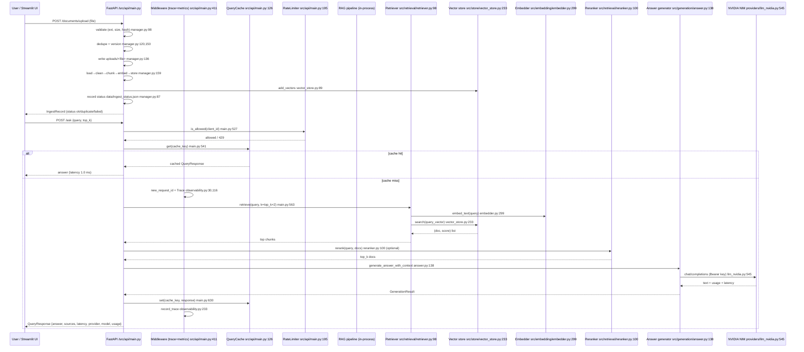

# 02 — System Architecture

**Audience:** senior QA / automation engineer. You know program flow, CI/CD, and test
frameworks, but production architecture (concurrency, auth boundaries, observability,
deployment, scaling) is not your home turf. This doc grounds every claim in the actual
source, config, Dockerfile, and docker-compose.yml with `file:line` citations.

> **Analogy to keep in your head:** think of this system like a telecom provisioning
> operation. Ingestion = loading a new tariff / circuit record into the operations support
> system (OSS). The vector store = the circuit inventory database. Retrieval = querying
> that inventory for circuits that match a fault symptom. Answer generation = the NOC
> engineer writing the trouble-ticket resolution, quoting only the inventory record, and
> saying "I can't determine this from the inventory" when the record is silent. Caching
> = a fast lookup table (MAC/ARP cache). Rate limiting = a policer on an access port.
> Auth = RADIUS/TACACS+ at the network edge.

## 1. What this system is (and is not)

- **It is** a retrieval-augmented generation (RAG) question-answering service: ingest
  documents, embed their chunks, store the vectors, then answer user questions using only
  the retrieved chunks as evidence.
- **It is NOT** a source of new telecom knowledge. Per the project teaching rules
  (`CLAUDE.md`), all answers must be grounded in retrieved document chunks; the system
  must refuse ("I don't have enough information…") when evidence is missing, never
  speculate.
- **Purpose/source mismatch:** the ingested documents under `data/raw/` are generic Acme
  Corp corporate policies (HR leave, IT security, benefits, travel), NOT the LTE/5G,
  Roaming, SIM Security, eSIM documents the project's stated purpose describes
  (`docs/learn/_plan.md:48`). Treat all architecture claims below as describing the
  *mechanism* regardless of which documents happen to be loaded.

## 2. System diagram (components + connections)

Mermaid flowchart. The dashed line is the trust boundary (auth / validation / secrets
apply on the API side of it).

```mermaid
flowchart TD
    %% Clients
    subgraph Client["Client layer (outside trust boundary)"]
        UI[Streamlit UI :8501<br/>ui/streamlit_app.py]
        CURL[curl / pytest / test client]
    end

    %% Trust boundary
    subgraph API["FastAPI API :8000 (uvicorn) — INSIDE trust boundary"]
        direction TB
        MW[HTTP middleware<br/>request id + metrics + trace<br/>src/api/main.py:411]
        AUTH[AuthN / AuthZ<br/>verify_api_token + verify_user_role<br/>src/api/main.py:268,287]
        CACHE[QueryCache<br/>in-memory, FIFO, MD5 key<br/>src/api/main.py:126]
        RL[RateLimiter<br/>sliding window, in-memory<br/>src/api/main.py:195]
        RT[/ask, /ask/stream, /search<br/>src/api/main.py:501,647,712]
        ING[/ingest, /upload, /delete, /reindex<br/>src/api/main.py:779,903,863,956]
        AGT[/agent/ask<br/>src/api/main.py:978]
        FB[/feedback<br/>src/api/main.py:1014]
        MW --> AUTH
        AUTH --> RT & ING & AGT & FB
        CACHE -.-> RT
        RL -.-> RT
    end

    %% Pipeline
    subgraph Pipe["In-process RAG pipeline"]
        direction TB
        QRY[Query rewriter + conversation memory<br/>src/retrieval/query_rewriter.py, conversation_memory.py]
        RET[Retriever: dense + BM25 + RRF<br/>src/retrieval/retriever.py, sparse_retriever.py, hybrid.py]
        RR[Reranker<br/>cross-encoder / metadata<br/>src/retrieval/reranker.py]
        ANS[Answer generator + grounded prompt<br/>src/generation/answer.py, prompt.py]
        AGENT[RAGAgent + ToolRegistry allow-list<br/>src/agent/agent.py, tools.py]
        QRY --> RET --> RR --> ANS
        AGENT -.-> RET
    end

    %% Store
    subgraph Store["Vector store — ChromaDB, in-memory fallback"]
        VS[(ChromaDB<br/>data/chroma_db<br/>src/store/vector_store.py)]
    end

    %% External LLM
    subgraph Ext["External service"]
        NIM[NVIDIA NIM<br/>https://integrate.api.nvidia.com/v1<br/>providers/llm_nvidia.py]
    end

    %% Data / state
    subgraph Data["State on disk"]
        UPL[uploads/ staging<br/>src/ingestion/manager.py:28]
        KEY[data/key_registry.json<br/>src/key_pool.py:25]
        STS[data/ingest_status.json<br/>src/ingestion/manager.py:29]
        EMB[data/embedding_cache/<br/>src/embedding/embedder.py:159]
    end

    %% Connections
    UI -->|HTTP JSON / SSE| API
    CURL -->|HTTP JSON| API
    API -->|wires| Pipe
    RET -->|nearest-neighbour| VS
    ANS -->|chat/completions| NIM
    ING -->|writes + indexes| UPL
    ING -->|writes chunks| VS
    AGT -->|validated tool calls| RET
    ANS -.->|tokens/usage| CACHE
```

### How to read this diagram

- **Clients** sit outside the trust boundary. The Streamlit UI talks to the API over plain
  HTTP (JSON for `/ask`, SSE for `/ask/stream`) — `ui/streamlit_app.py:16` reads
  `API_BASE_URL` (default `http://localhost:8000`).
- Everything **inside `API`** is inside the trust boundary: authN/authZ, caching, rate
  limiting, and the request middleware run on every call.
- The **pipeline** runs in-process inside the API; there is no separate retrieval service
  or message bus. Retrieval calls the vector store; generation calls NVIDIA NIM over the
  network.
- The **data/state** layer is all on the local filesystem (no managed database service).

## 3. Components list — responsibility + implementing files

Each entry states what the component does and where it lives (`file:line`). Line numbers
refer to the repository at `learn/annotated`.

| # | Component | Responsibility | Files (file:line) |
|---|-----------|----------------|-------------------|
| 1 | **Settings / config** | Reads *only* environment variables; fail-fast when `LLM_PROVIDER=nvidia` but no NVIDIA key; holds SMTP, alert, and `api_token` config. | `src/config.py:22` (`Settings`), `src/config.py:52` (`get_settings`), `src/config.py:65` (missing-key check) |
| 2 | **Key pool** | Thread-safe round-robin pool of NVIDIA API keys with failover on 401/403. Only key *fingerprints* (first4…last4) are logged; registry is local JSON. | `src/key_pool.py:54` (`KeyPool`), `src/key_pool.py:70` (`from_env`), `src/key_pool.py:118` (`current_key`), `src/key_pool.py:149` (`mark_bad`), `src/key_pool.py:25` (registry path) |
| 3 | **Key monitor** | CLI tool to register key expiries, live-probe keys against NVIDIA `/models`, and email alerts via SMTP when keys expire soon. | `src/key_monitor.py:53` (`register_key`), `src/key_monitor.py:86` (`probe_key`), `src/key_monitor.py:125` (`send_alert`), `src/key_monitor.py:166` (`main`) |
| 4 | **Observability** | Structured JSON logs with secret redaction, per-request correlation IDs, per-stage tracing (retrieve/rerank/llm/total), in-memory counters + latency histograms + token usage, recent-trace ring buffer (100 entries). | `src/observability.py:27` (`request_id_ctx`), `src/observability.py:42` (`_SECRET_PATTERNS`), `src:observability.py:92` (`setup_logging`), `src/observability.py:116` (`Trace`), `src/observability.py:166` (`Metrics`), `src/observability.py:225` (`metrics` global) |
| 5 | **Embedder** | sentence-transformers (`all-MiniLM-L6-v2`, 384-d) embedding with content-hash disk cache, retry-with-backoff, rate limiting, and graceful degradation to a deterministic mock vector on any failure. | `src/embedding/embedder.py:154` (`Embedder`), `src/embedding/embedder.py:240` (`_get_content_hash`), `src/embedding/embedder.py:286` (`_embed_text_internal` + retry), `src/embedding/embedder.py:299` (`embed_text`), `src/embedding/embedder.py:352` (`embed_batch`), `src/embedding/embedder.py:508` (`_mock_embed`) |
| 6 | **Vector store** | ChromaDB `PersistentClient` at `data/chroma_db`, collection `rag_academy`; nearest-neighbour cosine search; falls back to in-memory lists when Chroma is unavailable. | `src/store/vector_store.py:22` (`VectorStore`), `src/store/vector_store.py:44` (`_initialize_client`), `src/store/vector_store.py:233` (`search`), `src/store/vector_store.py:465` (`get_stats`) |
| 7 | **Loaders** | Read PDF/DOCX/TXT/MD into `{content, metadata}`; PDF/DOCX never fabricate text (record extraction errors instead). Basic metadata includes source, filename, department, access_level, doc_version, is_current. | `src/ingestion/loaders.py:12` (`DocumentLoader`), `src/ingestion/loaders.py:125` (`PDFLoader`), `src/ingestion/loaders.py:176` (`DocxLoader`), `src/ingestion/loaders.py:240` (`get_loader_for_file`), `src/ingestion/loaders.py:260` (`load_documents_from_directory`) |
| 8 | **Cleaner** | HTML unescape, tag stripping, whitespace/newline normalization. | `src/ingestion/cleaner.py:10` (`TextCleaner`), `src/ingestion/cleaner.py:25` (`clean_text`) |
| 9 | **Chunker** | Splits text into chunks: fixed-size, recursive (paragraph→sentence→fixed), or structure-aware (markdown headings). Default 500 chars / 50 overlap. | `src/ingestion/chunker.py:11` (`ChunkingStrategy`), `src/ingestion/chunker.py:17` (`TextChunker`), `src/ingestion/chunker.py:43` (`chunk_text`) |
| 10 | **Document manager (ingest lifecycle)** | Validate (extension + 10 MB cap), dedupe by SHA-256 content hash, version on filename collision, persist to `uploads/`, index (load→clean→chunk→embed→store), status log `data/ingest_status.json`, cascade delete, reindex. | `src/ingestion/manager.py:57` (`DocumentManager`), `src/ingestion/manager.py:28` (`UPLOAD_DIR`), `src/ingestion/manager.py:29` (`STATUS_FILE`), `src/ingestion/manager.py:98` (`validate`), `src/ingestion/manager.py:114` (`upload`), `src/ingestion/manager.py:159` (`_index_file`), `src/ingestion/manager.py:191` (`delete`), `src/ingestion/manager.py:201` (`reindex`) |
| 11 | **Ingest CLI** | `python -m src.ingestion.run` — runs the full load→clean→chunk→embed→store pipeline from `data/raw`. | `src/ingestion/run.py:28` (`run_ingestion_pipeline`), `src/ingestion/run.py:172` (`main`) |
| 12 | **Retriever (dense)** | Embeds the query, asks the vector store for nearest neighbours, applies similarity threshold + `k` cap, optional `is_current=True` filter; fetches 3×k when filtering. No retry / circuit breaker. | `src/retrieval/retriever.py:51` (`Retriever`), `src/retrieval/retriever.py:98` (`retrieve`) |
| 13 | **Sparse (BM25)** | Keyword scorer built from stdlib only; in-memory index (no persistence, no locking). | `src/retrieval/sparse_retriever.py:53` (`BM25Retriever`), `src/retrieval/sparse_retriever.py:185` (`retrieve`) |
| 14 | **Hybrid / RRF** | Fuses dense + sparse rankings with Reciprocal Rank Fusion (position-based, so different score scales combine fairly). `weight_dense`/`weight_sparse` are stored but not actually applied in the RRF math. | `src/retrieval/hybrid.py:51` (`HybridRetrieverRRF`), `src/retrieval/hybrid.py:129` (`_reciprocal_rank_fusion`), `src/retrieval/retriever.py:302` (`_doc_key`) |
| 15 | **Reranker** | Cross-encoder re-scoring (`cross-encoder/ms-marco-MiniLM-L-6-v2`) degrades to passthrough when unavailable; `MetadataReranker` applies cheap metadata boosts. | `src/retrieval/reranker.py:53` (`Reranker`), `src/retrieval/reranker.py:100` (`rerank`), `src/retrieval/reranker.py:160` (`MetadataReranker`) |
| 16 | **Query rewriter** | Rule-based telecom abbreviation expansion (LTE→Long Term Evolution, etc.) and HyDE-style hypothetical-document templates. The LLM-backed path is accepted but never invoked (placeholder). | `src/retrieval/query_rewriter.py:50` (`QueryRewriter`), `src/retrieval/query_rewriter.py:71` (`rewrite_query`), `src/retrieval/query_rewriter.py:98` (`expand_query`) |
| 17 | **Conversation memory** | In-memory chat history (max 10 turns) that condenses follow-up questions ("what about it?") into standalone queries via rule-based pronoun resolution. LLM path is a placeholder. | `src/retrieval/conversation_memory.py:50` (`ConversationMemory`), `src/retrieval/conversation_memory.py:105` (`condense_question`) |
| 18 | **LLM provider interface** | `LLMProvider` ABC (`generate`, `get_model_info`) so the rest of the system stays provider-agnostic. Mock provider for dev/tests; placeholders for OpenAI/Anthropic (not wired to real clients). | `providers/llm.py:46` (`LLMProvider`), `providers/llm.py:111` (`MockLLMProvider`), `providers/llm.py:312` (`create_llm_provider`), `providers/llm.py:377` (`create_llm_provider_from_env`) |
| 19 | **NVIDIA provider (production)** | Calls `integrate.api.nvidia.com/v1/chat/completions` with Bearer auth, retries+backoff on timeout/429/5xx, key-pool failover on 401/403, token-usage collection, per-call latency timing, API-key redaction, streaming (SSE), and structured JSON output with Pydantic validation. Blocking `httpx.Client` + `time.sleep` (no async, no jitter). | `providers/llm_nvidia.py:226` (`NVIDIAProvider`), `providers/llm_nvidia.py:420` (`_post` + retries/failover), `providers/llm_nvidia.py:545` (`chat`), `providers/llm_nvidia.py:612` (`stream_chat`), `providers/llm_nvidia.py:671` (`chat_json`), `providers/llm_nvidia.py:201` (`_redact`) |
| 20 | **Prompt engineering** | Grounded prompt templates (`grounded_v1`/`v2`, `citation_focused`) that instruct the LLM to answer only from context, cite `[source_filename]`, and refuse when evidence is insufficient. `format_context` builds the cited context block with dedupe and char-count truncation. | `src/generation/prompt.py:43` (`PromptTemplate`), `src/generation/prompt.py:117` (`PromptEngineer`), `src/generation/prompt.py:282` (`format_context`), `src/generation/prompt.py:351` (`create_grounded_prompt`) |
| 21 | **Answer generator** | Builds context within a 2000-token budget (chars-per-token estimate), renders the grounded prompt, calls the LLM provider (or mock), returns a `GenerationResult` with answer, sources, latency, token counts, provider/model. Streaming variant emits SSE token events. | `src/generation/answer.py:15` (`GenerationResult`), `src/generation/answer.py:29` (`AnswerGenerator`), `src/generation/answer.py:63` (`_build_context_within_budget`), `src/generation/answer.py:138` (`generate_answer_with_context`), `src/generation/answer.py:235` (`stream_answer_with_context`), `src/generation/answer.py:363` (`GroundedAnswer` schema), `src/generation/answer.py:373` (`create_answer_generator`) |
| 22 | **RAG chat (CLI)** | `python -m src.generation.chat` — end-to-end demo: builds the full pipeline on construction, `query()` retrieves (top_k×2), reranks to top_k, generates, prints answer/sources/latency/tokens. | `src/generation/chat.py:34` (`RAGChat`), `src/generation/chat.py:88` (`_initialize_pipeline`), `src/generation/chat.py:157` (`query`) |
| 23 | **Controlled agent** | Deterministic-first tool-using agent: plans (heuristic or LLM), validates + authorizes + executes allow-listed tools with timeouts, step cap (5), repeat cap (2). Returns answer + sources + tool-call trace. | `src/agent/agent.py:50` (`RAGAgent`), `src/agent/agent.py:62` (`plan`), `src/agent/agent.py:108` (`run`), `src/agent/tools.py:80` (`ToolRegistry`), `src/agent/tools.py:102` (`execute`), `src/agent/tools.py:165` (`build_default_tools`) |
| 24 | **FastAPI app** | HTTP entry point. Request middleware (request id, metrics, trace). Endpoints: `/ask`, `/ask/stream`, `/search`, `/ingest`, `/documents/*` (list/upload/delete/status/reindex), `/agent/ask`, `/feedback`, `/health`, `/metrics`, `/traces`, `/provider`. | `src/api/main.py:404` (`app`), `src/api/main.py:411` (`log_requests` middleware), `src/api/main.py:440` (`startup_event`), `src/api/main.py:501` (`/ask`), `src/api/main.py:647` (`/ask/stream`), `src/api/main.py:779` (`/ingest`), `src/api/main.py:978` (`/agent/ask`) |
| 25 | **Query cache** | In-memory cache keyed by MD5 of the full request (query + all flags); FIFO eviction at 200 entries; no TTL (stale answers persist until evicted). | `src/api/main.py:126` (`QueryCache`) |
| 26 | **Rate limiter** | Per-client sliding window (30 req / 60 s), in-memory only — resets on restart, not shared across uvicorn workers. | `src/api/main.py:195` (`RateLimiter`) |
| 27 | **Streamlit UI** | Browser UI: Ask (streaming SSE), Search, Agent, Traces & Metrics, Documents tabs; sidebar access-level picker (0–3). Calls the API via `requests`. | `ui/streamlit_app.py:16` (`API_BASE_URL`), `ui/streamlit_app.py:56` (`main`) |
| 28 | **Evaluation** | Retrieval metrics (hit-rate@k, recall@k, MRR, nDCG) and generation metrics (LLM-as-judge relevance/faithfulness/contradiction). Golden set at `src/evaluation/golden_set.json`. | `src/evaluation/metrics.py:16` (`RetrievalMetrics`), `src/evaluation/metrics.py:244` (`GenerationMetrics`), `src/evaluation/run_eval.py:53` (`RAGEvaluationPipeline`) |

## 4. Data flow of the main use case

The main use case has two phases: **(A) ingest a document**, then **(B) ask a question → get an answer**. File:line citations at each hop.

### Phase A — Ingest a document (upload path)

1. **Client sends file** → `POST /documents/upload` (`src/api/main.py:903`). Streamlit UI uploads via `requests.post` to `/documents/upload` (`ui/streamlit_app.py:193`).
2. **AuthZ** — `verify_user_role` requires `can_ingest` (admin, level 3) (`src/api/main.py:287`, `src/api/main.py:261`); `verify_api_token` checks bearer token when configured (`src/api/main.py:268`).
3. **Validate** — `DocumentManager.validate()`: plain filename, allowed extension (`.pdf/.docx/.md/.txt`), non-empty, ≤10 MB; returns SHA-256 content hash (`src/ingestion/manager.py:98`).
4. **Dedupe** — compare content hash + filename against existing vector-store sources (`src/ingestion/manager.py:120`); identical → status `duplicate`, no re-index.
5. **Version** — if filename exists with different hash, mark old chunks `is_current=False` (`vector_store.mark_source_current`, `src/store/vector_store.py:181`) and bump `doc_version` (`src/ingestion/manager.py:150`).
6. **Persist** — write bytes to `uploads/<filename>` (`src/ingestion/manager.py:136`).
7. **Index pipeline** — `_index_file` (`src/ingestion/manager.py:159`):
   - `load_document` → loader by extension (`src/ingestion/loaders.py:254`, `get_loader_for_file` at `:240`)
   - `clean_documents` → HTML/whitespace normalize (`src/ingestion/cleaner.py:78`, `clean_text` at `:25`)
   - `chunk_documents` → recursive, 500/50 (`src/ingestion/chunker.py:249`, `chunk_text` at `:43`)
   - `embed_documents` → content-hash cache + model/mock embedding (`src/embedding/embedder.py:461`, `embed_text` at `:299`)
   - `add_documents_to_store` → ChromaDB or fallback (`src/store/vector_store.py:535`, `add_vectors` at `:89`)
8. **Record status** — append `IngestRecord` to `data/ingest_status.json` (capped at 500) (`src/ingestion/manager.py:87`, `:70`).
9. **Response** — `IngestRecord.to_dict()` returned to caller (`src/ingestion/manager.py:50`).

### Phase B — Ask a question → get an answer

1. **Client sends question** → `POST /ask` (`src/api/main.py:501`) or `/ask/stream` (`:647`). Streamlit UI calls `/ask` (`ui/streamlit_app.py:101`) or `/ask/stream` (`:35`).
2. **AuthN/AuthZ** — `verify_api_token` + `verify_user_role` (`src/api/main.py:268`, `:287`); access level is forwarded as `X-Access-Level` header (client-controlled when no token — see §6).
3. **Rate limit** — `RateLimiter.is_allowed(client_id)`; 429 if over 30/60s (`src/api/main.py:195`, checked at `:527`).
4. **Cache lookup** — `QueryCache.get()` keyed by MD5 of query + flags; hit returns cached response immediately (`src/api/main.py:126`, `:541`).
5. **Middleware trace** — `new_request_id()` + `Trace` + `metrics.inc("requests_total")` (`src/api/main.py:411`, `src/observability.py:30`, `:116`, `:176`).
6. **Retrieve** — `retriever.retrieve(query, k=top_k×2, current_version_only=True)` → embed query (`embedder.embed_text`, `src/embedding/embedder.py:299`) → `vector_store.search` cosine nearest neighbours (`src/store/vector_store.py:233`) → threshold + cap (`src/retrieval/retriever.py:98`). Traced as stage `retrieve` (`src/api/main.py:562`).
7. **(Optional) rerank** — `Reranker.rerank` re-scores top candidates (`src/retrieval/reranker.py:100`), cut to `top_k`. Traced as stage `rerank` (`src/api/main.py:574`).
8. **Generate** — `AnswerGenerator.generate_answer_with_context`: build context within 2000-token budget (`src/generation/answer.py:63`), `create_grounded_prompt` v2 (`src/generation/prompt.py:351`), call LLM provider (`providers/llm_nvidia.py:545` NVIDIA chat, or mock `providers/llm.py:136`). Traced as stage `llm` (`src/api/main.py:588`). Provider usage + latency recorded (`providers/llm_nvidia.py:588`, `src/observability.py:184` `add_tokens`).
9. **Cache write** — `QueryCache.set()` (`src/api/main.py:630`).
10. **Response** — `QueryResponse` with answer, sources, latency, feedback_id, provider, model, usage (`src/api/main.py:617`). Feedback logged in background (`log_feedback_request`, `:1065`).
11. **Stream variant** — SSE `data:` events per token, then a `done` event with sources/usage, then `[DONE]` (`src/api/main.py:669` `event_gen`, `src/generation/answer.py:235` `stream_answer_with_context`).

> **QA analogy:** Phase A is like provisioning a new circuit into the OSS inventory (validate the service order, check for duplicates, write the record, index it). Phase B is like a fault ticket: the technician queries the inventory for matching circuits (retrieve), picks the most relevant (rerank), writes the resolution quoting only the inventory record (generate), and says "not in inventory" when nothing matches.

## 5. Sequence diagram (main use case: ingest → ask → answer)



## 6. Trust boundaries (where auth / validation / secrets apply)

The trust boundary is the **FastAPI API layer**. Everything to the left of it (UI, curl, tests) is untrusted.

| Boundary | Mechanism | File:line | Notes |
|----------|-----------|-----------|-------|
| **API authN** | `Authorization: Bearer <API_TOKEN>` compared with `hmac.compare_digest`; no-op (dev mode) when `API_TOKEN` unset. Token never logged. | `src/api/main.py:268` | When unset, any caller is authenticated — acceptable for local dev, not for production exposure. |
| **API authZ (roles)** | `X-Access-Level` header → role (guest/employee/manager/admin) with `can_ingest` / `can_delete` flags. `/ingest`, `/upload`, `/delete`, `/reindex` require admin. | `src/api/main.py:287`, `:261`, `:804`, `:911`, `:882`, `:963` | **Weakness:** when `API_TOKEN` is unset, the header is client-controlled, so a caller can assert admin. Treat role as advisory unless token auth is on. |
| **Mutating endpoints** | `/documents/upload`, `/documents/{source}` DELETE, `/documents/reindex`, `/ingest` all gated on `can_ingest`/`can_delete`. | `src/api/main.py:903-921`, `:863-901`, `:956-969`, `:779-861` | |
| **Path traversal** | `resolve_safe_ingest_dir` confines `data_directory` to project `data/` or `uploads/`. | `src/api/main.py:315` | Protects `/ingest` and `/reindex` from `../../etc` escapes. |
| **Tool allow-list (agent)** | `ToolRegistry.execute`: Pydantic schema validation → admin authorization → thread-pool timeout (30 s) → record audit trail. LLM can only *propose*; it never gets raw filesystem/DB/OS access. | `src/agent/tools.py:102`, `:165` (`generate_report` requires admin) | `ToolContext.is_admin` derived from `can_ingest` (`src/api/main.py:997`). |
| **Secret redaction (logs)** | `RedactFilter` scrubs `nvapi-…`, `sk-…`, `Bearer …` patterns from every log record. | `src/observability.py:42`, `:57` | Defense in depth; NVIDIA provider also redacts its key locally (`providers/llm_nvidia.py:201`). |
| **Secret storage** | Keys never in source. `NVIDIA_API_KEY`/`NVIDIA_API_KEYS` from env; `.env` gitignored and excluded from the Docker image (`.dockerignore:1-4`). Only key *fingerprints* persisted to `data/key_registry.json` (gitignored). | `src/config.py:55-57`, `src/key_pool.py:28`, `.gitignore:10`, `.dockerignore:2` | |
| **Never fabricate content** | PDF/DOCX loaders record extraction errors instead of inventing text; RAG prompt refuses when context is insufficient. | `src/ingestion/loaders.py:157-160`, `:205-207`, `src/generation/prompt.py:163-171` | Aligns with the project teaching rule "No Speculation" (`CLAUDE.md`). |

### Where the boundary is weak (call these out in review)

1. **Role header is client-controlled without token auth** — `src/api/main.py:291` explicitly notes this. If you expose this API without `API_TOKEN`, anyone can claim `X-Access-Level: 3`.
2. **Rate limiter and cache are per-process in-memory** — no Redis/shared store, so multiple uvicorn workers each have independent counters; a client can multiply its limit by worker count (`src/api/main.py:256`, `:257`).
3. **No circuit breaker on NVIDIA** — retries with backoff only (`providers/llm_nvidia.py:420`); a prolonged outage exhausts retries and fails the request.

## 7. Where state lives

| State | Location | Technology | Lifespan | File:line |
|-------|----------|------------|----------|-----------|
| **Vector store (embeddings + chunks + metadata)** | `data/chroma_db` | ChromaDB `PersistentClient`, collection `rag_academy`; in-memory lists as fallback | Persistent across restarts (Chroma); fallback lost on restart | `src/store/vector_store.py:27`, `:44`, `:81`; `Dockerfile:21` |
| **Embedding cache** | `data/embedding_cache/` | Per-content-hash JSON files (MD5 of text) | Persistent; no invalidation or TTL | `src/embedding/embedder.py:159`, `:244` |
| **Key registry (expiry/fingerprints)** | `data/key_registry.json` | JSON, gitignored, local only | Persistent; managed by `src/key_monitor.py` | `src/key_pool.py:25`, `:184` (`save_registry`) |
| **Uploads (staging for ingested files)** | `uploads/` | Plain files, write-only staging | Persistent; deleted on cascade delete | `src/ingestion/manager.py:28`, `:136`, `:197` |
| **Ingest status log** | `data/ingest_status.json` | JSON list of `IngestRecord`, capped at 500 | Persistent; old records dropped beyond 500 | `src/ingestion/manager.py:29`, `:89` |
| **Query cache** | RAM (API process) | Dict, MD5-keyed, FIFO max 200, no TTL | Process lifetime only | `src/api/main.py:151`, `:171` |
| **Rate limiter** | RAM (API process) | Dict of client_id → timestamp lists, sliding window | Process lifetime; resets on restart; not shared across workers | `src/api/main.py:219`, `:222` |
| **Metrics (counters, latency, tokens, errors)** | RAM (API process) | `Metrics` object, thread-safe | Process lifetime | `src/observability.py:166`, `:225` |
| **Recent traces** | RAM (API process) | Ring buffer, last 100 traces | Process lifetime | `src/observability.py:230`, `:239` |
| **Feedback store** | RAM (API process) | Plain list `feedback_store` | Process lifetime only ("in production, this would be a database") | `src/api/main.py:258`, `:1047` |
| **Conversation memory** | RAM (per agent/chat instance) | List of turns, max 10 | Instance lifetime | `src/retrieval/conversation_memory.py:69` |
| **BM25 index** | RAM (per retriever instance) | In-memory token index | Instance lifetime; rebuilt on re-ingest | `src/retrieval/sparse_retriever.py:72` |

**No managed database service is used.** ChromaDB is embedded and file-backed; everything else is in-process memory or local files. This is simple to operate but does not survive multi-node deployment without shared storage.

## 8. What scales and what does not

### Scales (within a single node)

| Component | Why it scales | Limit |
|-----------|---------------|-------|
| **Vector store (ChromaDB)** | Persistent, nearest-neighbour search; handles the ingested corpus on one node. | Single-node Chroma; no sharding/replication. |
| **Embedding disk cache** | Avoids re-embedding identical text; biggest latency/cost win on re-ingest. | Grows without bound (no TTL/eviction); `Embedder.clear_cache` exists (`embedder.py:558`) but isn't automated. |
| **Key pool + failover** | Rotates NVIDIA keys on 401/403, so one revoked key doesn't take down generation. | Pool size is static (env at startup); no dynamic key addition without restart. |
| **Per-stage tracing + metrics** | Gives you per-request timing breakdown (retrieve/rerank/llm) for profiling. | Ring buffer capped at 100 traces; metrics are in-memory counters only. |

### Does NOT scale (single-node / in-process)

| Component | Why not | File:line | Production implication |
|-----------|---------|-----------|------------------------|
| **Query cache** | In-memory dict, per-process, no TTL, no cross-worker sharing. | `src/api/main.py:126` | Stale answers persist; cache doesn't survive restart or scale behind a load balancer. |
| **Rate limiter** | Per-process sliding window; resets on restart; no Redis backing. | `src/api/main.py:195` | Client can multiply limit by worker count; state lost on deploy. |
| **Metrics + traces** | In-memory, per-process. | `src/observability.py:166`, `:230` | No historical retention; no distributed tracing across services. |
| **Feedback store** | Plain Python list. | `src/api/main.py:258` | Lost on restart; not queryable. |
| **BM25 index** | In-memory, no persistence or locking. | `src/retrieval/sparse_retriever.py:72` | Rebuilt on every re-ingest; not safe for concurrent writes. |
| **Conversation memory** | In-memory list per instance. | `src/retrieval/conversation_memory.py:69` | Doesn't survive restart or share across servers. |
| **Document manager status log** | JSON file, capped at 500 records, no concurrency control. | `src/ingestion/manager.py:87` | Records dropped beyond 500; not safe for concurrent writers. |
| **NVIDIA provider I/O** | Blocking `httpx.Client` + `time.sleep` backoff (no async, no jitter). | `providers/llm_nvidia.py:276`, `:386` | Blocks the event loop if called from async context; thundering-herd risk on 429. |
| **Fallback vector store** | In-memory lists; lost on restart. | `src/store/vector_store.py:81` | If Chroma is unavailable, all vectors vanish when the process restarts. |

**Bottom line:** this is a single-node, single-process prototype-grade deployment. It is operationally simple (one Docker image, local files, no external DB) but is not ready for multi-instance, multi-tenant, or high-traffic production without: a shared cache/rate-limit store (Redis), persistent durable feedback/telemetry, async NVIDIA client with circuit breaker, and role auth backed by a real identity provider.

## 9. Deployment notes (Docker)

- **Image:** `python:3.11-slim`, torch pre-installed CPU-only, then `requirements.txt`; code copied in; `.env`, `.git`, caches excluded (`.dockerignore`); runs as non-root `appuser` (`Dockerfile:28`); exposes port 8000; healthcheck hits `http://localhost:8000/health` (`Dockerfile:37`); `CMD uvicorn src.api.main:app --host 0.0.0.0 --port 8000` (`Dockerfile:41`).
- **Compose:** two services — `api` (port 8000, `LLM_PROVIDER` defaults to `mock`, mounts `./data`, `./uploads`, `./logs`) and `ui` (Streamlit on 8501, `API_BASE_URL=http://api:8000`, depends on `api` healthy) (`docker-compose.yml:3-41`). Optional nginx reverse proxy is commented out (`docker-compose.yml:44-53`).
- **Secrets:** never baked into the image; `.env` is gitignored and excluded from the build context (`Dockerfile:24` comment, `.dockerignore:1`).

## UNVERIFIED claims

The following items were inferred from reading the code but not confirmed by running the system:

1. The system actually starts and serves requests end-to-end (`uvicorn src.api.main:app` + Streamlit) — no run was performed as part of this task.
2. ChromaDB is installed and the persistent vector store path `data/chroma_db` is active at runtime (the in-memory fallback may be used if `chromadb` is missing).
3. The `sentence-transformers` model `all-MiniLM-L6-v2` downloads/loads successfully (if unavailable, the mock embedder is used silently — `src/embedding/embedder.py:233`).
4. Line numbers are accurate for the current `learn/annotated` working tree; if any source file shifted, a small number of `file:line` references may be off by a line or two.
5. The NVIDIA provider path (`LLM_PROVIDER=nvidia`) was not exercised; behavior depends on a real API key and network access to `integrate.api.nvidia.com`.

---

**Related docs in this series:** `00_START_HERE.md`, `01_business_context.md`, `03_glossary.md`, `04_gap_bridge.md`, `05_trace_walkthrough.md`, `06_interview_pack.md`, `07_issues_found.md`. No source code was modified to produce this document.